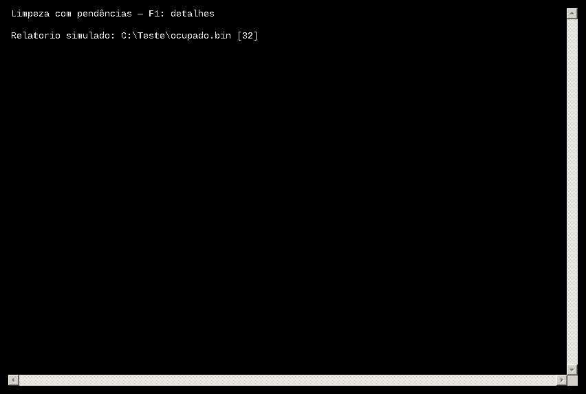

# FSC 2

Interface nativa Windows x64 em C++20 para as três DLLs existentes. O código da interface está inteiro em [`main.cpp`](main.cpp). Usa Win32, Direct2D e DirectWrite, sem navegador, ImGui ou dependências externas de UI.

Prévia capturada no Wine, com fonte substituta:


[Ver layout em janela estreita](preview-mobile.png)

## Usar

Baixe e extraia **FSC-Windows-x64-v2.zip**, mantendo os quatro binários na mesma pasta:

```text
FSC.exe
Limpeza.dll
Registro.dll
arquivos.dll
```

Abra `FSC.exe`. O manifesto solicita elevação pelo UAC padrão do Windows para as operações que precisam de acesso administrativo. Use a mesma conta do seu perfil: elevar com outra conta muda as pastas pessoais e `HKEY_CURRENT_USER` usados pelas DLLs.

Pressione e segure um card por **2000 ms**. Soltar antes, sair do card ou perder o foco cancela o hold e zera a borda. O início da operação ocorre no primeiro evento/frame com tempo acumulado de pelo menos 2000 ms; o Windows não oferece agendamento de tempo real.

**O hold dispara a operação real, sem outra confirmação.** A Limpeza e o Registro podem excluir dados permanentemente; Arquivos substitui arquivos de mesmo nome. O aplicativo mantém o comportamento das DLLs publicadas anteriormente, sem ampliar seu escopo.

## Design e interação

- Fundo preto puro com pequenos pontos discretos e somente tons de cinza/branco.
- Título centralizado com espaçamento entre letras. Seleciona Inter, Space Grotesk, Segoe UI Variable Display ou uma fonte sans-serif alternativa instalada.
- Exatamente três cards quadrados com ícone e nome. Três colunas em janelas largas, empilhados abaixo de 760 DIPs.
- Contorno vetorial progressivo no perímetro, equivalente visual à borda SVG solicitada; é desenhado nativamente com Direct2D, sem carregar SVG no navegador.
- Percentual durante o hold. Ao iniciar a DLL, uma animação discreta indica trabalho em andamento.
- Check/flash e aviso de conclusão somente quando a DLL retorna sucesso. Falhas ou resultados parciais recebem mensagem própria.
- Estado visual retorna suavemente ao normal. Não há métricas, barra de status ou subtextos decorativos.
- `Tab`/`Shift+Tab` ou setas mudam o foco; segure `Espaço` ou `Enter` para executar. `Esc`/`Alt+F4` fecham a janela quando não há tarefa em andamento.
- Controles discretos de minimizar/fechar, arraste pela faixa superior e redimensionamento pelas bordas. Suporte a DPI por monitor.

## Integração exata

| Card | Arquivo esperado | Funções usadas |
| --- | --- | --- |
| Limpeza | `Limpeza.dll` | `int LimparPc()` |
| Registro | `Registro.dll` | `int LimparRegistroSilencioso()` |
| Arquivos | `arquivos.dll` | `void PerformFilesCopy()` e `DWORD FilesGetLastStatus()` |

`arquivos.dll` é a `Files.dll` criada anteriormente, renomeada no pacote. Esses nomes correspondem à imagem enviada.

As bibliotecas são carregadas pelo caminho absoluto da pasta do executável, usando `LoadLibraryExW`/`GetProcAddress`. A pasta de trabalho atual não é usada para localizar as DLLs. Exportações incompatíveis são rejeitadas sem chamada; não se chama uma função de `rundll32` com uma assinatura diferente.

As operações rodam em thread separada, uma por vez. O status de Arquivos é consultado nessa mesma thread. A janela continua responsiva; o fechamento espera a operação retornar. Não há interrupção forçada de cópias ou exclusões. Uma DLL defeituosa ainda pode encerrar o processo: não há isolamento de execução de plugins.

`LimparPc` e `LimparRegistroSilencioso` fornecem apenas sucesso/resultado parcial. A versão 2 também consulta o relatório detalhado de cada DLL e o disponibiliza com F1, incluindo códigos e caminhos das falhas.

## Compilar no Visual Studio 2022

Instale **Desenvolvimento para desktop com C++** e o Windows SDK. Abra `FSC.sln`, selecione **Release / x64** e compile. O projeto copia as DLLs das pastas vizinhas e renomeia `Files.dll` para `arquivos.dll` no diretório de saída.

Ou abra o **x64 Native Tools Command Prompt** nesta pasta e execute:

```bat
compilar.bat
```

Saída: `bin\x64\Release\FSC.exe`, acompanhado das três DLLs. O script não executa nenhuma ação de manutenção. `main.cpp` também pode ser usado em um projeto Windows C++20, vinculando `d2d1.lib`, `dwrite.lib`, `ole32.lib`, `user32.lib`, `gdi32.lib` e incluindo o recurso/manifesto fornecido. Salve como UTF-8 e compile com `/utf-8`.


## FSC 2: checagem de administrador e F1

O executável verifica `TokenElevation` na entrada e solicita a elevação padrão `runas` caso necessário. As três DLLs fazem sua própria verificação antes das operações. O manifesto `requireAdministrator` permanece incorporado. A recusa/cancelamento do UAC não é contornada.

Após qualquer tarefa, pressione **F1** para abrir uma janela de leitura com contagens, estado de elevação e códigos/caminhos das falhas. O relatório permanece apenas em memória e não é enviado ou salvo automaticamente. Um resultado parcial continua parcial; elevação não torna removíveis arquivos abertos e chaves protegidas por ACLs.

Baixe o novo **FSC-Windows-x64-v2.zip** e extraia as quatro peças juntas. As exportações adicionais `CleanerGetLastReport`, `RegistryGetLastReport` e `FilesGetLastReport` precisam ser consultadas na mesma thread da operação. O FSC copia os textos antes de descarregar a DLL. DLLs antigas são identificadas como sem suporte ao relatório detalhado.

O fonte inclui `../common/Diagnostics.h` e os projetos vinculam `shell32.lib` e `advapi32.lib` além das bibliotecas gráficas. A compilação MSVC e a validação de UAC/ACLs no Windows 11 Pro real permanecem pendentes.

Validação da versão 2: **71 verificações passaram** (14 limpeza, 15 Registro, 18 cópia, 24 interface/diagnóstico). Duas verificações de reparse points foram puladas por limitação do Wine. A janela F1 foi aberta e seu texto conferido com DLL simulada. Não foram realizados testes destrutivos nas pastas reais ou no BAM real do usuário.



Para recompilar o pacote inteiro no Visual Studio 2022, execute `compilar-tudo.bat` no x64 Native Tools Command Prompt.

## Validação e limites

O executável e as DLLs foram compilados para Windows x64 com MinGW-w64 GCC 14.2, runtime C++ estático e avisos tratados como erros. A compilação MSVC ainda não foi executada neste ambiente Linux.

As 71 verificações no Wine usaram arquivos e chaves artificiais. Duas verificações de links/reparse points ficaram sem validação. A versão anterior passou também por seis verificações interativas dos cards e dos layouts; a versão 2 teve sua janela F1 aberta e seu conteúdo conferido com DLL simulada.

Para repetir a integração com DLLs simuladas, use `tests\testar.bat`. Não substitua os mocks pelas DLLs reais. A limpeza, o Registro e a cópia têm seus próprios testes nas pastas vizinhas.

Ainda é necessária validação no Windows 11 Pro real: UAC, ACLs, arquivos bloqueados, nuvem/OneDrive e os dados do usuário não foram homologados por estes testes.
