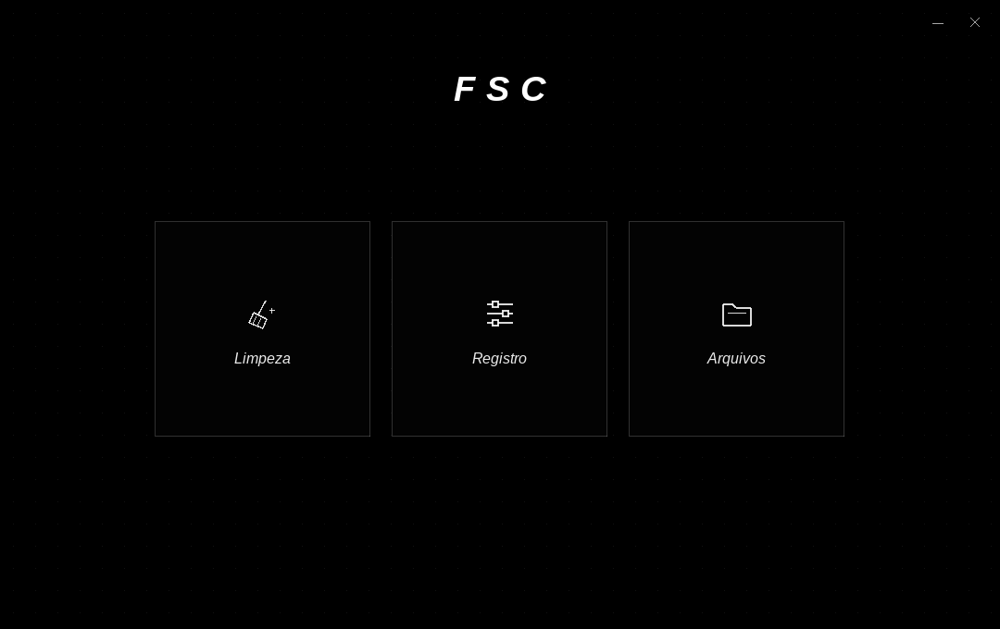

# FSC 3

Interface nativa Windows x64 em C++20 para `Limpeza.dll`, `Registro.dll` e `arquivos.dll`. Win32, Direct2D e DirectWrite, sem dependências externas de UI.

## Pacote completo

Baixe [FSC-Windows-x64-v3.zip](FSC-Windows-x64-v3.zip), extraia **tudo em uma pasta nova** e abra `FSC.exe`. O ZIP inclui os quatro binários prontos, instruções e os fontes completos em `fontes/ferramentas`.

```text
FSC.exe
Limpeza.dll
Registro.dll
arquivos.dll
LEIA-ME.txt
fontes/
```

O executável solicita administrador pelo UAC padrão. Use a mesma conta do seu perfil: fornecer outra conta muda as pastas pessoais e `HKEY_CURRENT_USER`. Nenhuma permissão protegida é contornada.

Pressione e segure um card por **2000 ms**. Soltar antes, sair do card ou perder o foco cancela o hold. O início ocorre no primeiro evento/frame com tempo acumulado de pelo menos 2000 ms; o Windows não oferece agendamento de tempo real. Há uma operação por vez.

**O hold executa a operação real, sem outra confirmação.** Limpeza e Registro podem excluir dados permanentemente; Arquivos substitui arquivos de mesmo nome. Downloads permanece fora da limpeza, conforme a alteração anterior do pedido. O escopo das três DLLs permanece o mesmo da versão 2.

## Correção do crash ao executar cards

A versão anterior descarregava a DLL antes de a thread terminar. As DLLs passaram a usar relatórios em `thread_local std::wstring`, que podem registrar destruidores dentro da própria biblioteca. Descarregá-la antes desses callbacks é inseguro. Um reprodutor que consulta apenas o relatório, sem executar manutenção, ficou bloqueado na saída da thread no Wine com o descarregamento antigo; mantendo a DLL carregada, a thread terminou normalmente. O crash específico do computador do usuário ainda exige validação nele.

Na versão 3:

- Cada card executa em **um processo auxiliar separado**, usando o próprio `FSC.exe`. A interface não carrega as DLLs de manutenção.
- Os módulos ficam carregados até a saída do auxiliar, preservando os destruidores locais à thread. Relatório e status são consultados na mesma thread da operação.
- Uma falha nativa no auxiliar é informada no F1 com código hexadecimal, como `0xC0000005`. A janela principal continua aberta. Não há repetição automática de uma ação parcialmente executada.
- O resultado atravessa um pipe com protocolo e limites de tamanho. Somente o handle de escrita necessário é herdado. A leitura precede a espera do processo, evitando bloqueio com relatórios maiores que o buffer do pipe.
- As notificações de conclusão não transportam ponteiros; um resultado sincronizado também é consultado pelo timer caso a notificação não entre na fila.

Não substitua apenas o EXE de uma instalação antiga: extraia o pacote inteiro. Se uma DLL falhar, a operação pode ter ocorrido parcialmente; consulte **F1** antes de repeti-la.

O processo auxiliar herda a elevação do executável principal. As três DLLs também verificam `TokenElevation`. O fechamento normal espera a operação terminar; não há cancelamento forçado de cópias ou exclusões. Um auxiliar que ficar bloqueado continuará sendo aguardado; isolamento de crash não equivale a cancelamento seguro.

## Interface

- Fundo preto com pontos discretos, título FSC e três cards quadrados: Limpeza, Registro e Arquivos.
- Cards em três colunas acima de 760 DIPs; empilhados em janelas estreitas.
- Borda vetorial progressiva, percentual durante o hold, flash/check somente após sucesso e mensagem discreta no rodapé.
- Fontes Inter, Space Grotesk, Segoe UI ou alternativa sans-serif instalada.
- `Tab`/setas mudam de card; segure `Espaço`/`Enter` para executar. `F1` abre os detalhes da última operação. `Esc`/`Alt+F4` fecham quando não há tarefa em andamento.
- Janela redimensionável e suporte a DPI por monitor.



[Layout estreito](preview-mobile.png). As imagens ilustram a interface; não são capturas de homologação no Windows 11.

## Integração das DLLs

| Card | Biblioteca | Exportações |
| --- | --- | --- |
| Limpeza | `Limpeza.dll` | `int LimparPc()`, `CleanerGetLastReport()` |
| Registro | `Registro.dll` | `int LimparRegistroSilencioso()`, `RegistryGetLastReport()` |
| Arquivos | `arquivos.dll` | `void PerformFilesCopy()`, `DWORD FilesGetLastStatus()`, `FilesGetLastReport()` |

`arquivos.dll` é a `Files.dll` renomeada. As funções de relatório retornam `const wchar_t*`. Bibliotecas são carregadas exclusivamente pelo caminho absoluto ao lado do EXE com `LoadLibraryExW`/`GetProcAddress`. Uma exportação ausente gera erro de incompatibilidade. Resultados parciais não são apresentados como sucesso.

F1 mostra contagens e códigos/caminhos de falha retornados pela DLL. Os relatórios ficam em memória; não são enviados ou gravados automaticamente. Administrador não torna removíveis arquivos abertos ou chaves protegidas por ACLs.

## Compilar

Visual Studio 2022 com **Desenvolvimento para desktop com C++** e Windows SDK, plataforma **x64**, C++20. No **x64 Native Tools Command Prompt**, na pasta `fontes/ferramentas/fsc` do ZIP ou `ferramentas/fsc` do repositório:

```bat
compilar-tudo.bat
```

Saída: `bin\x64\Release\FSC.exe` e as três DLLs. O script compila os quatro componentes sem executar manutenção. `compilar.bat` compila somente a interface e copia as DLLs já existentes. Alternativamente, abra `FSC.sln` em Release/x64.

O fonte da interface está em `main.cpp` e inclui `../common/Diagnostics.h`. O recurso `FSC.rc` incorpora o manifesto administrativo. Bibliotecas: `d2d1.lib`, `dwrite.lib`, `ole32.lib`, `user32.lib`, `gdi32.lib`, `shell32.lib`, `advapi32.lib`. Use `/utf-8`.

## Validação

Build Windows x64 com MinGW-w64 GCC 14.2, runtime estático e `-Wall -Wextra -Werror`. Validação no Wine, usando exclusivamente DLLs simuladas para os cards:

- **44 verificações de integração**: limite de 2000 ms, layouts, DLLs ausentes/incompatíveis, erros parciais, relatórios, saída de threads com TLS, execução isolada dos três cards, relatório grande, pacotes inválidos, violação de acesso em cada auxiliar e execução seguinte após crash.
- **26 verificações da janela** em `tests/gui.cpp`: hold curto, execução real do fluxo dos três cards com mocks, F1, redimensionamento e três crashes nativos sem encerrar a interface.
- O reprodutor com DLL real chamou somente o getter do relatório. Nenhuma limpeza real nem alteração do BAM real foi usada para testar o crash.

Para repetir com MSVC, execute `tests\testar.bat` em um **x64 Native Tools Command Prompt aberto como administrador**. O script prepara uma pasta exclusiva com mocks; não substitua esses mocks pelas DLLs reais.

A compilação MSVC e o funcionamento no **Windows 11 Pro real** ainda não foram validados neste ambiente Linux. UAC, ACLs, OneDrive e dados reais exigem validação nesse sistema. O arquivo `SHA256SUMS.txt` permite conferir os binários e o ZIP publicado.
